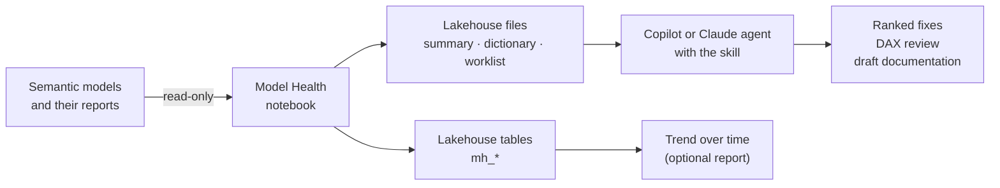

# Power BI Model Health

A read-only health check for Power BI semantic models that live in Microsoft Fabric workspaces, in two parts:

- **A Fabric notebook** that scans your models and writes a short, ranked list of what to fix.
- **An Agent Skill** that teaches a Copilot or Claude agent to explain those results, review your DAX, and draft documentation for your DAX and Power Query.

Nothing in any model or report is changed. The notebook opens everything read-only and writes only to the lakehouse you attach.

> **Status: 0.6.0, pre-release.** The code is tested against the source of Semantic Link Labs 0.18.1, a simulated Fabric workspace, and a real local Spark 3.5. It has **not yet been run on a live Fabric tenant**. See [What's verified](#whats-verified-and-what-isnt) before you rely on it.

## What you get

From a workspace full of models, one screen per model. This is the top of [`examples/summary.md`](examples/summary.md), produced from the test suite's synthetic workspace:

| Dataset Name | Status | Errors | Key Warnings | Warnings | Info | Measures | Described | Commented | Unused | Unused Confidence |
|---|---|---|---|---|---|---|---|---|---|---|
| Sales Model | OK | 0 | 1 | 4 | 19 | 3 | 33% | 0% | 3 | Medium |
| Tiny | OK | 0 | 1 | 1 | 5 | 0 |  |  | 2 | Low |
| Broken | FAILED at Read model metadata |  |  |  |  |  |  |  |  |  |

Then, for each model, the issues grouped and ranked so the important ones come first (excerpt):

| Severity | Area | Issue | Count | Examples | Fix |
|---|---|---|---|---|---|
| Warning | Star schema | Table has no relationships and has visible columns. | 1 | Store | If it is a slicer or parameter table, hide what users shouldn't pick and add a description; otherwise relate it to the model or remove it. |
| Warning | BPA: Formatting | Provide format string for measures | 1 | Unused | Set a format string on each measure. |
| Info | Usage | Unused objects (2 hidden, 1 visible) | 3 | Sales[Margin], … | Confidence Medium. See the unused-objects section; never delete straight from the list. |
| Info | Documentation | Other documentation gaps | 16 | 5 Tables without descriptions; 10 Columns without descriptions; … | Lower priority: describe user-facing tables/columns; add header comments to Power Query steps. |

After that come the unused objects with a confidence level, the model's shape, documentation gaps, and what changed since the last run. The other example files show the rest:

- [`examples/summary_Sales_Model.md`](examples/summary_Sales_Model.md): one model in full
- [`examples/dictionary_Sales_Model.md`](examples/dictionary_Sales_Model.md): data dictionary with relationships, DAX and Power Query
- [`examples/doc_worklist_Sales_Model.csv`](examples/doc_worklist_Sales_Model.csv): what needs documenting, ready for drafts

## How it works



## Quick start

1. **Import** [`notebook/Model_Health_Phase1.ipynb`](notebook/Model_Health_Phase1.ipynb) into a Fabric workspace (*Import → Notebook*).
2. **Attach a lakehouse** in the notebook's Explorer pane. Results are saved there.
3. In **Step 1 — Settings**, set `DATASETS = ["One Small Model"]`. If the lakehouse is in a different workspace from your models, also set `WORKSPACE`.
4. Select **Run all**. Step 4 (Preflight) checks the setup in a few seconds and stops with a plain message if something is missing.
5. Read the results in **Step 7**, or download `summary.md` from the lakehouse (**Files → model_health → latest**) and give it to your agent.

The only cell you edit is Step 1. The other code cells are collapsed where Fabric honours that setting; expand any of them to read the code.

### What you need

| Requirement | Why |
|---|---|
| Fabric Runtime 1.3 (Spark 3.5) | Semantic Link Labs 0.18.1 depends on it. The first cell checks. |
| XMLA endpoints enabled for the tenant and capacity | The model metadata is read over XMLA. |
| **Contributor** on the model's workspace, or **Write** on each model | Build alone can run queries but can't read the full metadata. |
| **Contributor** on the workspaces that hold the reports | Needed to read report definitions. Reports you can't read are listed, and confidence drops. |
| *Optional:* workspace monitoring | For the query-log check, which is the only way to see Excel usage. |

### Installing Semantic Link Labs

The notebook's Step 0 gives three options:

- **A Fabric Environment** with `semantic-link-labs==0.18.1`. Best for scheduled runs, and the dependable choice for pipelines and High Concurrency sessions.
- **`%pip`** in the notebook. This is the default, and installs for the session.
- **Offline wheels**, for when PyPI is blocked. The exact download command is in the notebook.

## What it checks

| Check | How |
|---|---|
| **Best practices** | The Best Practice Analyzer from Semantic Link Labs. Rules this notebook covers better are dropped, the rest are grouped by rule, and common ones come with a short, checked fix. |
| **Star schema** | Every table gets a role: fact, dimension, snowflaked or bridge, many-to-many, measure table, parameter, and so on. It flags disconnected tables, facts with no link to the date table, one-to-one relationships and tables joined only by inactive relationships. |
| **Unused columns and measures** | A dependency graph built from the model, plus every report bound to it. Details below. |
| **Documentation** | Description and comment coverage, a data dictionary, a worklist for drafting, and change tracking between runs. |
| **Size** | Vertipaq column sizes, matched to the unused list. |

## How far to trust "unused"

A false "unused" can break a report if someone acts on it, so the notebook follows one rule: **when in doubt, an object counts as used.**

An object is used if anything reaches it from:

- a report visual, filter, bookmark, report-level measure or visual calculation (new and legacy report formats)
- a relationship, a key column, row-level security, a calculation item or a KPI
- a field parameter, or an aggregation table's mapping
- another used object's DAX, its Sort By or Group By column, or a hierarchy a report uses
- the workspace monitoring query logs, when you turn that check on

Every model then gets a confidence level, and the removal advice depends on it:

| Confidence | Meaning | Advice given |
|---|---|---|
| **High** | Every bound report was read, and nothing else depends on the model. | Hidden objects are "strong candidates". |
| **Medium** | Some reports couldn't be read, or paginated reports or other models depend on this one. | "Likely" candidates. Check the named items first. |
| **Low** | No reports found, the scan was off, or lineage was unavailable. | Remove nothing. |
| **Unknown** | The report scan failed, or no bound report could be read. | Remove nothing. |

Query logs raise confidence only when they verifiably cover the period: at least 14 days, monitoring data reaching back that far, and fewer than 50,000 queries.

**What the scan can't see:** reports you don't have access to (including other people's *My workspace*), Excel and ad-hoc DAX unless the query-log check is on and verified, and Q&A visuals. That's why nothing is ever called "safe to delete", and why the procedure is always: hide → check query logs for 2–4 weeks → back up → remove.

## What gets written

**Files** in the lakehouse under `Files/model_health/latest/`, with a dated copy of each run under `runs/`:

| File | For |
|---|---|
| `summary.md` | The whole workspace: scorecard, plus detail for up to three models |
| `summary_<model>.md` | One model in full |
| `dictionary_<model>.md` | Relationships, every table and column, full DAX and Power Query |
| `doc_worklist_<model>.csv` | Objects that need a description or comment, in priority order, with blank draft columns |
| `top_issues.csv`, `top_findings.csv`, `unused_candidates.csv` | Detail rows |

**Delta tables**, appended on every run and keyed by run, workspace and model ID: `mh_findings`, `mh_unused_objects`, `mh_usage_confidence`, `mh_star_schema_tables`, `mh_relationships`, `mh_documentation`, `mh_changes`, `mh_column_sizes`, `mh_report_scan` and `mh_run_log`. A Power BI report over them shows whether health is improving.

Column-by-column reference: [`output-tables.md`](skills/powerbi-model-health/references/output-tables.md).

## Settings

All in Step 1 of the notebook. It's the parameters cell, so a pipeline or schedule can override any of them.

| Setting | Default | Meaning |
|---|---|---|
| `WORKSPACE` | `None` | Workspace to scan. `None` means the attached lakehouse's workspace, else the notebook's. |
| `DATASETS` | `[]` | Models to scan. Empty means all of them. Names aren't case-sensitive. |
| `SKIP_DATASETS` | `[]` | Models to leave out. |
| `RUN_BPA` | `True` | Best Practice Analyzer. |
| `RUN_VERTIPAQ` | `True` | Column sizes. |
| `SCAN_REPORTS` | `True` | Read report definitions for field usage. |
| `MONITORING_DAYS` | `0` | Also check this many days of query logs (up to 30). 14 or more can raise confidence. |
| `WRITE_TO_LAKEHOUSE` | `True` | `False` shows results in the notebook only. |
| `TABLE_PREFIX` | `"mh_"` | Prefix for the delta tables. |

## Using the skill

The skill is the folder [`skills/powerbi-model-health/`](skills/powerbi-model-health/SKILL.md): a `SKILL.md` and five reference files, in the open Agent Skills format. Build the upload packages with:

```bash
python tools/build.py
```

| Where | What to do |
|---|---|
| **Copilot Studio** | Open your agent → **Build → Skills → Upload a skill**, and upload `dist/copilot/powerbi-model-health.zip`. `SKILL.md` sits at the root of this zip. ([Microsoft Learn](https://learn.microsoft.com/en-us/microsoft-copilot-studio/agents-experience/skills-add-existing)) |
| **Agent Builder in Microsoft 365 Copilot** | If your tenant shows a Skills section, upload the same zip. If not, paste [`copilot/agent-instructions.md`](copilot/agent-instructions.md) into the agent's **Instructions**. It's a condensed version of the skill that fits the [8,000-character limit](https://learn.microsoft.com/microsoft-365-copilot/extensibility/copilot-studio-lite-build). |
| **Any Copilot chat** | Attach `SKILL.md` (or paste `agent-instructions.md`) along with your `summary.md`. |
| **Claude** | Upload `dist/claude/powerbi-model-health.zip`, which has the skill folder at its root. |

Then ask things like:

- "Here's my summary.md. What should I fix first?"
- "Review the DAX in this dictionary file, starting with the longest measures."
- "Fill in the draft descriptions for the first 15 rows of this worklist."

The agent is told to treat every description, comment and rewrite as a draft for you to approve, and never to call anything safe to delete.

## What's verified and what isn't

**Verified here**

- Every library call matches the source of semantic-link-labs 0.18.1 and semantic-link-sempy 0.14.3.
- The analysis logic has unit tests, including realistic report JSON in both formats.
- The whole notebook runs end to end against a simulated workspace, covering: a normal run, a model with no measures, every model failing, a failed table write and its retry, preflight stops, query logs on and partial, a paged lineage response, and re-running cells.
- Change tracking and all ten table writes run on a real local Spark 3.5.

**Only a live run can confirm**

- What the Fabric lineage API (beta) returns for your workspaces, and which reports it can see.
- How Excel appears in workspace monitoring logs.
- How your real reports parse, especially older ones.
- Run time on large models.
- Whether the collapsed-cell setting and rendered markdown look as intended in the Fabric notebook editor.
- Whether your Copilot accepts the file uploads and loads the skill's reference files.

The sensible first run is one small model with default settings.

## Repository layout

```
notebook/
  Model_Health_Phase1.ipynb    the notebook to import (generated; don't edit by hand)
  model_health_src.py          the same notebook as plain Python cells: edit this
skills/powerbi-model-health/
  SKILL.md                     the skill
  references/                  output reference, findings guide, DAX checklist, documentation style, troubleshooting
copilot/
  agent-instructions.md        condensed instructions for Agent Builder (under 8,000 characters)
examples/                      sample output from the test suite's synthetic workspace
tests/                         unit, end-to-end, local Spark and packaging tests
tools/
  build.py                     builds the notebook and the skill packages
  make_examples.py             regenerates examples/
```

## Development

Edit `notebook/model_health_src.py`, then build and test:

```bash
python tools/build.py              # notebook + dist/ packages
python tests/test_core.py          # analysis logic
python tests/test_e2e.py           # whole notebook against a simulated workspace
python tests/test_package.py       # notebook in sync, skill limits, package layout
python tests/test_spark.py         # needs Java and pyspark==3.5.x; takes a minute or two
python tools/make_examples.py      # refresh examples/ if the output changed
```

The tests need only `pandas`. `test_package.py` fails if the notebook is out of date with its source, so the two can't drift apart.

Version history is in [CHANGELOG.md](CHANGELOG.md).

## Roadmap

- **Validate on a live tenant**, then fix what that shows.
- **Write mode (not built):** apply approved descriptions, comments and format strings from the worklist, after backing up the model.
- **Cleanup and a "Start Here" page (not built):** staged removal of unused objects, and a generated README page inside reports.
